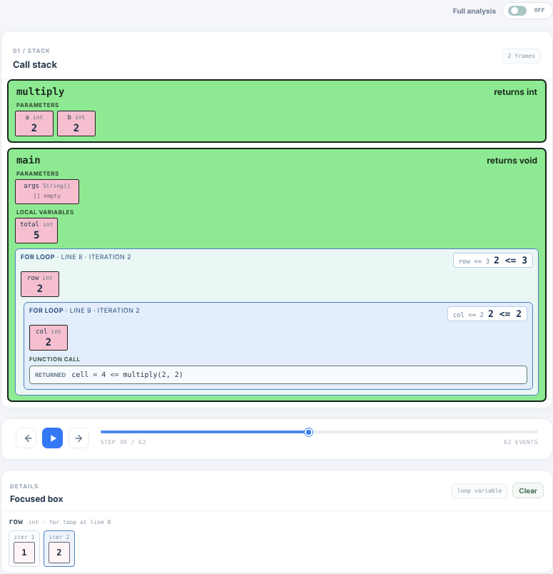
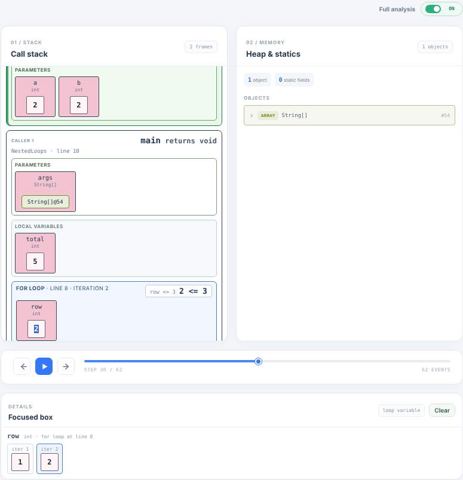

# Java Code Memory Visualizer

**Python Tutor for Java.** Paste a Java program, run it, and step through it line by line. At every step you see the call stack, each function's parameters and local variables, the calls a function is waiting on, the loops it is running, heap objects, static fields and console output.

Built as a CDAC final project: a Spring Boot backend traces real Java execution with the Java Debug Interface (JDI), and a React frontend turns that trace into an interactive visual.



## Features

- **Real execution, not simulation.** Code is compiled with the JDK compiler and run in a separate debug JVM; every line, call and return is recorded.
- **Call stack.** One box per active function with parameters, local variables and `this`, newest call on top; any function box can be collapsed and expanded.
- **Function call boxes.** A caller shows the call it is waiting on, e.g. `result = fun_add(0, 4)`, and after the return `result = 4 <= fun_add(0, 4)`. Hover to see the call as written (`fun_add(result, number)`). Works for recursion, several calls on one line and constructors (`n = Node@42 <= new Node(5)`).
- **Loop boxes.** Each running loop (`for`, for-each, `while`, `do-while`) is a box inside its function showing the iteration, its own variables, the calls made inside it and nested loops. The top-right corner shows the ending condition with live values (`i < times` → **`2 < 4`**) and ✓/✗ when it is checked. Double-click a loop variable to see its value in every iteration so far.
- **Heap & statics.** Objects, arrays, collections, aliases and cycles, linked to the variables that reference them by colour.
- **Two views.** *Full analysis* shows stack, heap and the Focused box; *Normal* mode shows compact frames with arrays and objects drawn inline.
- **State changes** per step, compile errors, runtime exceptions, program output and the raw JSON response.
- **Accounts.** Email/password signup with OTP verification, login via HttpOnly JWT cookie, password reset.
- **Run history.** Every *Run & visualize* is saved for the signed-in user with success/failure and the reason it failed (compiler errors, exception, blocked API, limit); `GET /api/runs` returns totals and recent runs. Source code is not stored.



## Tech stack

| Part | Technology |
|---|---|
| Backend | Java 21 (targets Java 17), Spring Boot 3.2, JDI, JavaParser, Spring Security (JWT), Spring Data JPA, Flyway |
| Database | H2 (local default), SQL Server / Azure SQL |
| Frontend | React 19, Vite 8 |
| Email OTP | Brevo (hosted profiles only) |

## Project layout

```text
java-visualizer/
├── backend/                  Spring Boot + Maven API (compiler, JDI tracer, auth)
│   ├── documentation/        Backend product/technical document and plan
│   └── samples/              Example programs and request bodies
├── frontend/                 React + Vite web app
│   └── documentation/        Frontend product/technical document and plan
├── docs/images/              README screenshots
├── plan.markdown             Overall plan, status table and change history
└── README.md
```

## Run locally

**Prerequisites:** JDK 21 (full JDK, not a JRE), Maven 3.8+, Node.js 20.19+ and pnpm (or npm).

Backend (terminal 1):

```powershell
cd backend
mvn spring-boot:run
```

Frontend (terminal 2):

```powershell
cd frontend
pnpm install
pnpm run dev
```

Open `http://localhost:5173`, sign up with any email, and enter OTP **`1234`** (the local profile does not send email). Pick an example such as **Nested loops with a function call** and press **Run & visualize**.

Run the tests with `mvn clean verify` in `backend/` and build the frontend with `pnpm run build` in `frontend/`. Eclipse users can import `backend/` as an existing Maven project and run `VisualizerApplication`.

## API (summary)

- `GET /health` → `{"status":"ok"}`
- `GET /api/auth/csrf`, `POST /api/auth/signup`, `/verify-email`, `/login`, `/logout`, `GET /api/auth/me`, password reset endpoints
- `GET /api/runs` (signed in) → `totalRuns`, `successfulRuns`, `failedRuns`, 20 most recent runs
- `POST /api/visualize` (signed in) with `{"code":"<Java source>"}` → status, trace steps (frames with variables, `calls` and `loops`, heap, line type, state changes), stdout, errors and metadata

Full details: [backend/README.md](backend/README.md) and [backend/documentation/document.markdown](backend/documentation/document.markdown).

## Status

| Area | Status |
|---|---|
| Visualizer core (trace, stack, heap, statics, state changes) | Done |
| Function-call boxes, loop boxes, stack-first layout, collapsible frames, compact variables | Done on `feature/function-box-implementation`; local build/browser check pending |
| Accounts (signup, OTP, JWT login, reset) | Implemented; end-to-end verification pending |
| Run history in the database | Implemented on the feature branch; `mvn clean verify` pending |
| Docker image, GitHub Actions CI/CD, Azure deployment config | Ready; Azure resources not created yet ([deployment guide](docs/DEPLOYMENT.md)) |
| DSA sheet / LeetCode problem picker | Future idea |

The detailed plan, status and change history live in [plan.markdown](plan.markdown), [backend/documentation](backend/documentation/) and [frontend/documentation](frontend/documentation/).

## Deployment

Azure Static Web Apps (frontend), Azure Container Apps (backend image from GitHub Packages), Azure SQL Database free offer and Brevo, deployed by GitHub Actions on every push to `main`. Step-by-step setup: [docs/DEPLOYMENT.md](docs/DEPLOYMENT.md).

## Safety

User programs run in a separate JVM under a Java Security Manager policy: no environment variables, no files except their own classes, no network, no new processes. A source blocklist, time/step/output limits, per-user rate limits and a non-root container add further guardrails. CPU and memory are not isolated per user, so treat a hosted instance as a private beta until the production-readiness review in [plan.markdown](plan.markdown).
